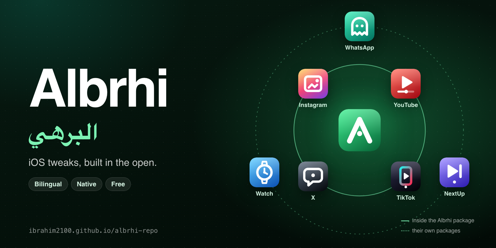
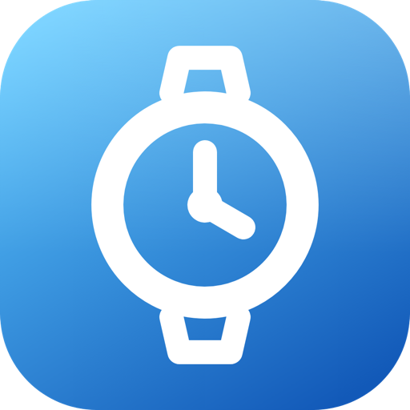
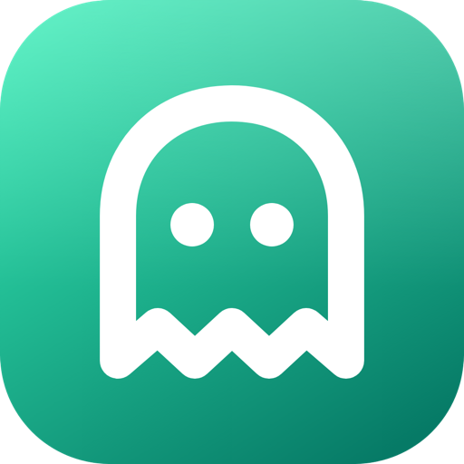
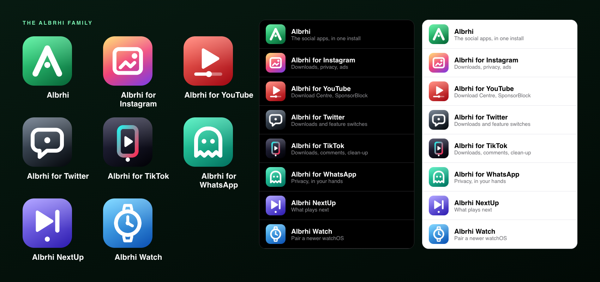

<p align="center"></p>

<p align="center">
  <b>iOS tweaks for Instagram, YouTube, X, TikTok, WhatsApp and more: bilingual, native, free.</b><br>
  <span dir="rtl">أدوات iOS بالعربي والإنجليزي، بواجهة تشبه التطبيق نفسه، ومجانية.</span>
</p>

<p align="center">
<a href="LICENSE"></a>
<a href="#-compatibility"></a>
<a href="#-compatibility"></a>
<a href="#-compatibility"></a>
</p>

<p align="center">
<a href="suite/CHANGELOG.md"></a>
<a href="tweaks/instagram/CHANGELOG.md"></a>
<a href="tweaks/youtube/CHANGELOG.md"></a>
<a href="tweaks/twitter/CHANGELOG.md"></a>
<a href="tweaks/tiktok/CHANGELOG.md"></a>
<a href="tweaks/ytmusic/CHANGELOG.md"></a>
<a href="tweaks/spotify/CHANGELOG.md"></a>
<a href="tweaks/panel/CHANGELOG.md"></a>
<a href="tweaks/nextup/CHANGELOG.md"></a>
<a href="tweaks/watch/CHANGELOG.md"></a>
</p>

---

## ⚡ Install

**1 · Add the source** in Sileo or Zebra (**Sources › ＋**):

```
https://ibrahim2100.github.io/albrhi-repo/
```

<p align="center">
  <a href="https://sharerepo.stkc.win/?repo=https://ibrahim2100.github.io/albrhi-repo/"></a>
  <a href="https://sharerepo.stkc.win/?repo=https://ibrahim2100.github.io/albrhi-repo/"></a>
</p>

**2 · Install _Albrhi_** (the package that carries Instagram, YouTube, X, TikTok and YouTube Music together), then respring. Pick **`com.albrhi.roothide`** on roothide and **`com.albrhi`** on rootless.
WhatsApp, NextUp and Watch are their own packages; the same four social tweaks are also listed one by one under **Single apps**.

**3 · Choose what it patches** in **Settings › Albrhi**. Every switch starts **off**: installing must never silently patch apps nobody asked about.

<sub>The address is lower case on purpose: GitHub Pages paths are case sensitive. Prefer a file? Every package is on the [Releases](https://github.com/ibrahim2100/albrhi-repo/releases) page. No jailbreak? See [sideloading](docs/sideloading.md).</sub>

---

## 🧭 The family

| Tweak | | Version | In Albrhi | What it does |
|---|:-:|---|:-:|---|
| **[Instagram](docs/tweaks/instagram.md)** |  | 4.9.4 | ✅ | downloads, a quieter feed, stories without a receipt, unsent messages kept and marked |
| **[YouTube](docs/tweaks/youtube.md)** |  | 1.51.2 | ✅ | a Download Centre tab, no ads, SponsorBlock, background playback |
| **[X](docs/tweaks/x.md)** |  | 0.23.0 | ✅ | media downloads with a button you place yourself, plus switches for what X does |
| **[TikTok](docs/tweaks/tiktok.md)** |  | 0.31.4 | ✅ | a download button in the feed, photo posts, no ads, privacy |
| **[YouTube Music](docs/tweaks/youtube-music.md)** |  | 0.10.1 | ✅ | synced lyrics, saving tracks, no ads |
| **[Panel](docs/tweaks/panel.md)** |  | 0.11.1 | ✅ | Settings › Albrhi: a switch per app, a guide, backup |
| **[Spotify](docs/tweaks/spotify.md)** |  | 0.2.5 | — | no ads, sponsored podcast segments skipped (not published yet) |
| **[NextUp](docs/tweaks/nextup.md)** |  | 0.3.1 | — | what plays next, on the Lock Screen (a GPLv3 port) |
| **[Watch](docs/tweaks/watch.md)** |  | 0.6.1 | — | pair a newer watchOS than iOS expects (an MIT port) |
| **[WhatsApp](https://github.com/ibrahim2100/albrhi-whatsapp)** |  | 0.3.0 | — | privacy for WhatsApp: no blue ticks, deleted messages stay (free, **closed source**) |

Each one is a self-contained project under `tweaks/`; they never meet at runtime (an injection filter binds each dylib to one app). [How it is made →](docs/how-it-is-made.md)

<p align="center"></p>

<sub>One icon template, one stroke and a signature dot; a colour and a glyph for each product. The glyphs are generic: nothing imitates another company's logo.</sub>

---

## 🧩 Compatibility

| | |
|---|---|
| **iOS** | 15.0 and later (NextUp 14.2–26) |
| **Architecture** | `arm64` and `arm64e` |
| **Jailbreaks** | Rootless (Dopamine, palera1n) · roothide · rootful (unc0ver, checkra1n) |
| **Instagram** | Tested on **410, 439 and 441**, from one build |
| **YouTube** | Tested on **21.47.6** (the direct route does not depend on the app version) |
| **X / Twitter** | Tested on **12.15** |
| **TikTok** | Tested on **47.8.0** |
| **NextUp** | Confirmed on **16.1** — Music, Podcasts, YouTube **21.32.4**, YT Music **9.28.4**, Spotify **9.1.62** |
| **Watch** | Any watchOS the pairing gate is asked about |

> The tested versions are the newest builds the developer's own phone accepts. They are not a ceiling:
> nothing is pinned to a version number, every class is looked up at runtime, and anything absent is
> skipped rather than crashed on. If one is not found, the **Diagnostics** page shows what the tweak can
> actually see on your phone and reports it in one tap.

---

---

## 🆓 Free

**Albrhi is free.** There is no licence, no key, no free week and no account; nothing is checked, and
nothing about you or your phone is asked for or sent anywhere in order to run it. Every tweak and every
setting is available from the first launch.

Earlier versions did need a licence. Updating removes that requirement for good — there is nothing to
enter and nothing to renew. An install that has not been updated yet keeps working as it did until it is.

---

> [!WARNING]
> **On roothide Bootstrap, Instagram 442 and newer crashes when you change your profile picture.** It is not caused by Albrhi: [how that was established](docs/known-issues.md). Turn Albrhi off for Instagram while you change a picture.

---

## 📚 Read more

[Usage](docs/usage.md) · [Sideloading](docs/sideloading.md) · [Building](docs/building.md) · [How it is made](docs/how-it-is-made.md) · [Roadmap](docs/roadmap.md) · [Contributing](docs/contributing.md) · [Who made what](NOTICE.md) · [Evidence and investigations](docs/README.md) · [Project rules (CLAUDE.md)](CLAUDE.md)

---

## 🙏 Credits

- **Ibrahim Ismail AL-Rahn** — Albrhi: every tweak, the bilingual layer, the Download Centres and the download and transcode engines, the panel, the source and its design.
- **[SoCuul](https://github.com/SoCuul)** — author of [SCInsta](https://github.com/SoCuul/SCInsta), where the **Instagram tweak** began (GPLv3). The other tweaks are not derived from it.
- **[YTKACE](https://github.com/itzzace/ytkace)** by itzzace (MIT) — the direct download method and several ad gates; **YTPlaybackFix** by Mark02 (MIT) — the playback-error recovery approach.
- **[iSponsorBlock](https://github.com/Galactic-Dev/iSponsorBlock)** by Galactic Dev (GPLv3) — the coloured progress-bar markers; **[SponsorBlock](https://sponsor.ajay.app)** by Ajay Ramachandran — the segment database (CC BY-NC-SA 4.0).
- **[YTMusicUltimate](https://github.com/dayanch96/YTMusicUltimate)** by **dayanch96** and **[YTMEnhanced](https://github.com/py233/YTMEnhanced)** by **py233** (GPLv3) — the YouTube Music hooks and synced-lyrics module. Their Premium claim deliberately is not carried over.
- **[EeveeSpotify](https://github.com/whoeevee/EeveeSpotify)** (GPLv3) — the Spotify ad blocking, without its Premium unlock.
- **[NextUp 3](https://github.com/Yves000/NextUp3)** by **Yves** (GPLv3) — Albrhi NextUp is a port of it; the design and nearly all of the implementation are his.
- **[watched](https://github.com/34306/watched)** by **34306** (MIT) — the Apple Watch pairing core.
- **[LightMessaging](https://github.com/rpetrich/libhooker)** by Ryan Petrich and **[libSandy](https://github.com/opa334/libSandy)** by opa334 — the messaging and sandbox profile NextUp needs.
- **[NeoFreeBird](https://github.com/orionblur/NeoFreeBird)** by **orionblur** (GPLv3, a BHTwitter fork written against X 12.31) — Albrhi for X carries over its timeline section filter, the typing-indicator and screenshot-detection approach, the quote/repost and whole-number counts, and a set of interface switches and feature-switch keys; its premium unlock, age-verification bypass, web login and posting, account-location lookup and Tenor GIF swap are deliberately not taken (see the X changelog).
- **[BHTikTok](https://github.com/BandarHL/BHTikTok)** by BandarHL and the fork by [al3raQe](https://github.com/al3raQe/BHTikTok), and **BHTwitter** — read for *where* an app is hookable, **never for code** (as is ProfileBanner by Nasser | NoTimeToChill, the small tweak that showed the profile-background editor was reachable); two compiled TikTok tweaks were read the same cautious way.
- **[JGProgressHUD](https://github.com/JonasGessner/JGProgressHUD)** by Jonas Gessner (MIT) · **[dav1d](https://code.videolan.org/videolan/dav1d)** by VideoLAN (the AV1 decoder) · **[FLEXing](https://github.com/SoCuul/FLEXing)** (runtime debugging).
- **Ibrahim Ismail AL-Rahn** — the Albrhi rebuild, bilingual layer, download and transcode engine, and design.

---

---

## 📬 Connect

| | |
|---|---|
| Instagram | [@Ib.11p](https://instagram.com/Ib.11p) |
| Snapchat | [@Ib.1p](https://snapchat.com/add/Ib.1p) |
| Telegram | [@Ib11p](https://t.me/Ib11p) |

---

---

## ⚖️ License

Copyright © Ibrahim Ismail AL-Rahn. Albrhi is distributed under the **GNU General Public License v3.0**
([LICENSE](LICENSE)); the released builds are free to run. Code that comes from other projects keeps its authors
and its licence: the Instagram tweak began from SCInsta (GPLv3), **Albrhi NextUp** is a port of NextUp 3, and
**Albrhi Watch** carries the MIT-licensed pairing core of *watched*. What came from where, tweak by tweak, is in
**[NOTICE.md](NOTICE.md)**.

*Albrhi is not affiliated with, endorsed by or sponsored by Instagram, Meta Platforms, Inc., Google, YouTube, X Corp., TikTok or Spotify.*
