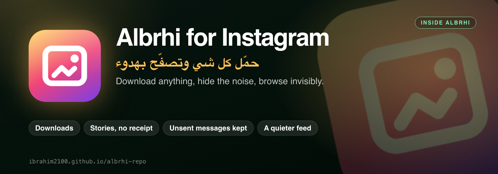

[← Albrhi](../../README.md)

# ✨ Albrhi for Instagram

## 📥 Downloads
- One-tap **download button** in the post and reel action rows — posts, reels, stories, **whole
  albums** (one slide or all), DM media and **HD profile pictures**.
- Always the best quality your iPhone can save. Some of Instagram's higher qualities come in a format
  iOS will not play; Albrhi converts those **on your phone**, keeping the HDR. Nothing is uploaded.
- **Download Center** — queue, pause, resume, retry, background transfers and history.
- Reel audio extraction · silent-video export · a dedicated Photos album.
- Stories (including a video story and a music-over-photo story) save as what they are, not as their
  poster frame.

## ✉️ Stories & Messages
- **Watch stories with no seen receipt.** The eye button still marks one as seen when you want it to.
- **Unsent messages stay.** When the other person takes a message back, it stays in the chat and gets
  a **red trash badge**, so you can tell which ones were taken back. *Confirmed on Instagram 410.*
  A **deleted-messages log** (Settings › Messages) keeps what each one said, who sent it and when — it survives the refresh that clears them from the chat.
- Hide your **"Active now"** status (experimental) · hide the typing indicator · save DM photos and
  videos, even view-once, with per-message mark-as-seen · full last-active time as a real date ·
  hide the voice and video call buttons · replay visual messages · disable screenshot detection.

## 🧹 Feed, Explore & Reels
Hide ads, sponsored and suggested posts · suggested users, reels and Threads posts · the stories tray ·
the entire feed · the explore grid · trending searches · the friends map · Meta AI · video autoplay.
Reels: tap-to-pause or mute · an always-on scrubber · auto-advance · anti doom-scrolling · hide the
header and blend button · refresh confirmation.

## 🔒 Confirmations
Optional prompt before like, follow, repost, call, voice message, follow-request response, Shh mode,
comment, chat-theme change, story-sticker tap and **chats refresh** (always asked while unsent messages are being kept, since a refresh removes them) — so a mis-tap never becomes a notification.

## 🎨 Appearance & profile
Custom **date & time formats** everywhere Instagram writes a time · **OLED black** · a custom accent
colour · a **follow-back badge** under the followers count (green *follows you* / red *doesn't*) · copy
account info.

## 🛠️ Interface
Native inset-grouped settings with **search** · **backup & restore** to a file · **copy a caption** by
long-press and **a comment** from a *Copy* button added to Instagram's own comment menu · full dark mode · Arabic/English with RTL · tab ordering, hiding and swipe-between-tabs ·
a **Diagnostics** page that reports what actually attached at runtime, scans the live view hierarchy,
and files an issue with the whole report in one tap.

---
