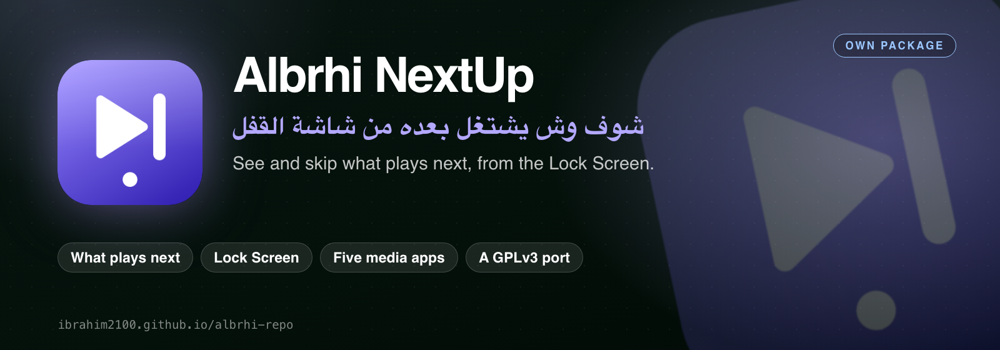

[← Albrhi](../../README.md)

# ⏭️ Albrhi NextUp

A row under the now-playing controls — the next track's title, artist and cover — on the **Lock Screen**,
in **Control Center** and in the **Dynamic Island**. Tap the cover to play it now, or skip it, without
opening the app that is playing.

| App | Support |
|---|---|
| **Apple Music** | Full |
| **Apple Podcasts** | Full |
| **YouTube Music** | Full — built against **9.28.4** |
| **YouTube** | Full — built against **21.32.4**. A playlist has a real queue; a standalone video shows YouTube's own autoplay suggestion, which is playable but not skippable |
| **Spotify** | Full — built against **9.1.62** |
| **SoundCloud** | Added with NextUp 3 1.2 |

Each row shows what that app itself would play next, read from its own queue — not a guess. The version
beside an app is the build its reader was written against; when a row goes blank after an update, that
number is the first thing to check.

**Settings › Albrhi › Albrhi NextUp** — a master switch, one per surface, one per app. Changes apply
immediately. **The master is off until you turn it on** (this port's own change), since it injects into
SpringBoard and five media apps. The log is compiled in and **off by default**, with a 128 KB ceiling per
process.

> **A port, not an original.** Albrhi NextUp is [NextUp 3](https://github.com/Yves000/NextUp3) by **Yves**,
> under the GNU GPL v3. The design, the private-API research and very nearly all of the implementation are
> Yves's work; this port replaced the Settings pane with a page of its own and rebranded the package.
> [Its changelog](../../tweaks/nextup/CHANGELOG.md) lists every change rather than letting it read as original.

> **It injects into SpringBoard.** A wrong hook there takes the home screen with it — have a way back in
> (SSH, or a package manager reachable from safe mode) first. On a jailbreak with per-app injection, the
> media apps need injection enabled too, or the row stays empty.

---
