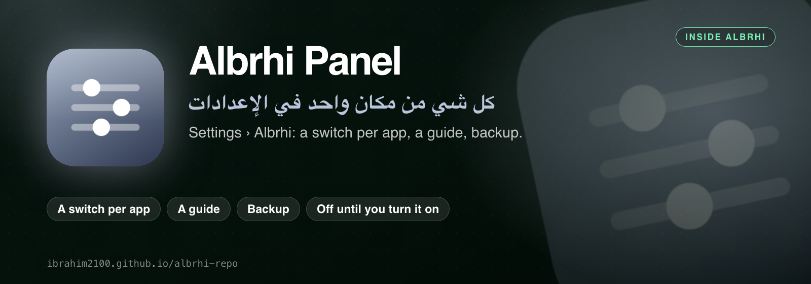

[← Albrhi](../../README.md)

# 🎛️ Albrhi Panel

**Settings › Albrhi.** The front door.

- **A switch per patched app**, opt-in, and a page for each tweak that has more to say than a switch.
- **One master switch above all of them.** When an app update breaks something, it stands every Albrhi
  tweak down on the next launch **without changing a single setting below it**.
- **A guide built from the device:** every tweak on *this* phone, what it does, the app version it was
  verified against and the version actually installed — built from the same scan as the main page, so it
  cannot describe a tweak that is not there.
- **Your settings, out and back** through the share sheet (a file written beside the preferences it
  copies would be destroyed by the very event it exists for). What it holds is stated; a file that is not
  ours is refused whole.
- **An update check, on a tap** — never on page load — that asks Albrhi's own source and keeps *could not
  be reached* distinct from *you are up to date*.

---
