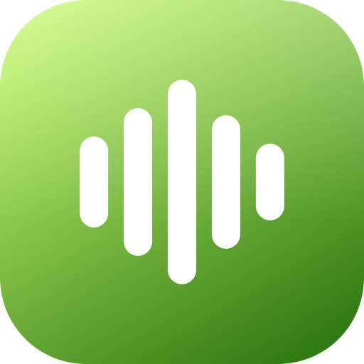

[← Albrhi](../../README.md)

# 🎧 Albrhi for Spotify

**No ads — and no Premium.** Audio and display ads are refused where Spotify asks for them, the home
feed's sponsored rows are filtered out of the JSON before the screen is built, and the "go Premium"
popups are dropped as they are presented.

**This does not unlock a paid subscription.** It does not touch your account, does not report you as a
subscriber, and does not raise the audio quality — those are account attributes the server decides, not
switches inside the app. The settings page says so above its own switches.

**Sponsored segments in podcasts** are skipped from SponsorBlock's database, with a note saying which
one. **Off until you turn it on:** it asks a third-party server about what is playing.

Written in **Swift and Orion**, the only tweak here that is. That costs things a Logos tweak does not:
the constructor is not called for you, a hook group must be activated behind a check that its target
exists, and SwiftUI cannot be compiled against the pinned SDK at all.

> **The ad blocking and SponsorBlock are not this project's work.** They are
> [EeveeSpotify](https://github.com/SideloadLabs/EeveeSpotifyReincarnated) by **Eevee** and the
> **SideloadLabs** team, under GPLv3. Every ported file is kept diffable against upstream; Albrhi adds the
> gate, the settings page and the bilingual interface.

---
