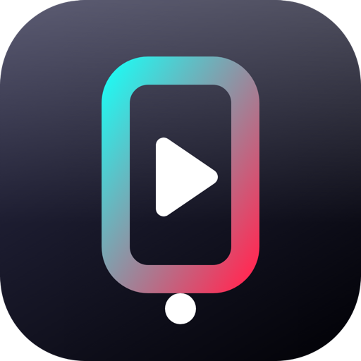

[← Albrhi](../../README.md)

# 🎵 Albrhi for TikTok

## ⬇️ A download button in the feed
A blurred disc with a down arrow, **above the profile picture** on every video, riding with TikTok's own
rail. It saves the clip you are **watching**, because the video is read from the controller the button
sits inside at the moment you tap it.

Quality is **measured, not guessed**: every link TikTok offers is collected and weighed by what it
actually is — a watermarked copy loses to a clean one, audio loses to video, and only then does size
decide. Optionally HD can be fetched from an outside service; **that switch is off and stays off until
you turn it on**, with its cost written on its own row (it tells that service which video you are
watching).

## 🖼️ Photo posts · 📅 the publish date · 💬 comments
- **Photo posts save as photos**, and it **asks first**: the picture you are on, or all of them. A
  single picture can also be saved **as a short video with the post's own sound**.
- **The publish date** sits above the download button — the day, the month by name, the year, and the
  time beneath.
- **Save a comment's sticker** *(off until you turn it on)* — a *Save to Photos* row in TikTok's own long-press
  menu on a comment that carries a sticker (an animated one is kept moving, as a GIF). TikTok's own row for a sticker
  only adds it to your favourite stickers. A comment with a *photo* is not touched: its author's choice still decides.
- **Copy a comment without the name** *(off until you turn it on)* — *Copy* puts the words on the clipboard, without
  `@name:` in front of them.
- When a feed shows TikTok's own date (the search results do), only ours is drawn — the full date and the time — instead of
  the two being written over each other.

## 🚫 Ads · ✋ Confirmations · 🔒 Privacy
An item TikTok's own server marked as an ad is refused as the object is built — and the launch splash
ad with it. Ask before a like or follow (off until you turn it on; if the question cannot be shown, the
tap goes through rather than "liking is broken"). **Three separate privacy switches** — a story's seen
mark, a message's read receipt, a profile view — because they are three different reports to three
different places. What shows on your own screen is never touched.

## 🧩 Extras
More logged-in accounts · **messages taken back stay visible and are marked as such** · a record of
profile visitors, kept as TikTok delivers them · the seek bar kept visible · the jailbreak answered for
as an unmodified phone would.
- **Profile background** *(off until you turn it on)* — TikTok has a profile-background editor built in and keeps
  it switched off from the server. This asks for it. **It tells TikTok your device is on that test list, which is
  not true**, so whether it works depends on TikTok for your account; the row says so.

## ⏳ Daily watch limit · 🗂️ readable file names
- **Daily limit** *(off until you choose)* — pick a number of videos or minutes; when you reach it a card shows what
  you watched and lets you keep going or take a break. It never locks anything and everything stays on the phone.
- Files you share (the audio of a video, for instance) are named `@account - start of the caption - id`.

## 🎛️ The settings screen
Rebuilt in 0.20.0: an identity card, a two-column grid of categories, and a card per option with an icon,
what it does, and its switch. The full diagnostic report is one row away and copyable in a tap. **Hold
two fingers anywhere.**

---
