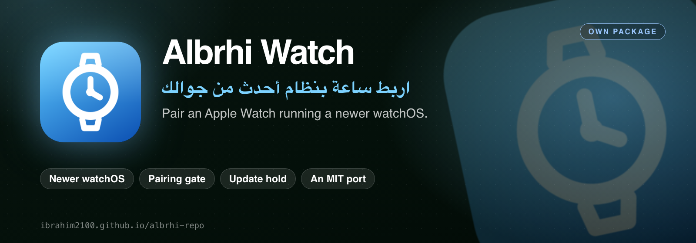

[← Albrhi](../../README.md)

# ⌚ Albrhi Watch

**Pair a watch iOS does not expect.** iOS refuses to pair with an Apple Watch whose watchOS is newer than
it expects. Watch answers those compatibility questions the way a supported pairing would — the pairing
gate, the declared capabilities, the companion-app runtime check — so setup completes and apps install.
*Confirmed on a device.*

**Hold watchOS 26 back** — a **filter, not a blanket refusal**: the version is read from the update
itself, so watchOS 26 and newer is withheld while security updates for the version your watch is on are
still offered. An update whose version cannot be read is let through. Nothing can start a held update: the
scan result, the install button's two actions, the download and the installation are each refused
separately — and **the Software Update page says Albrhi is the reason**, and names the switch that undoes
it, instead of iOS saying "up to date" in a sentence the tweak caused.

**Settings › Albrhi › Albrhi Watch.** The master is off until you turn it on. A pairing change is applied by
a **full userspace restart**, not a respring — measured on a device.

> **The pairing core is not this project's work.** It is [watched](https://github.com/34306/watched) by
> **34306**, under the MIT licence — carried over as code, with its notice shipped inside the package.

> **It injects into SpringBoard.** Have a way back in before installing any build.

---
