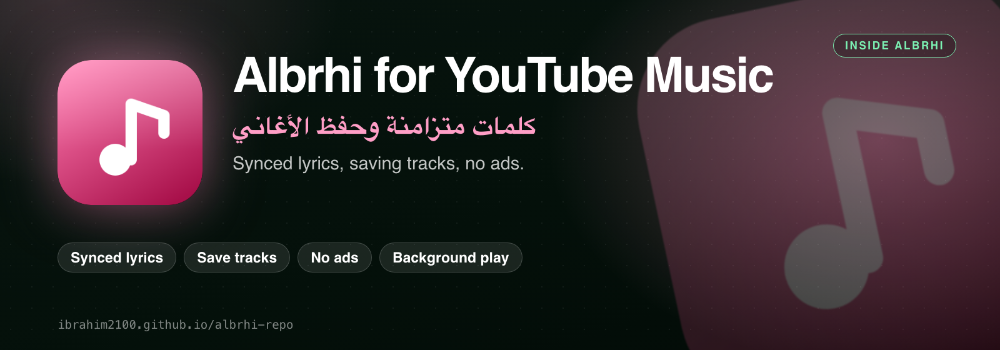

[← Albrhi](../../README.md)

# 🎼 Albrhi for YouTube Music

- **🎤 Synced lyrics**, with the current line lifted out. Six sources are asked and the best answer wins
  (LRCLib, Genius, MusixMatch, NetEase, the video description, YouTube Music's own); a wrong match is
  discarded rather than shown. CJK romanisation, selectable text, a pinned source, timing nudges, and
  optional translation with a key you supply yourself.
- **💾 Save a track** through the download button YouTube Music already draws — without FFmpeg — with a
  **Downloads tab** where the Upgrade tab used to be, and a player that behaves like the app's.
- **🚫 No ads**, the Premium advertisement and Upgrade tab hidden, **background playback** without the
  upsell notification, **no autoplay radio**, casting, and a true-black theme.
- **The speed control the app already has and hides**, seek buttons, and **SponsorBlock** for the one
  category a music app has (`music_offtopic`, off until you switch it on).

> A lyrics feature asks outside services what is playing. There is no version of it that does not — it is
> on because it was asked for by name.

**This does not unlock Premium.** The tweaks these hooks come from tell YouTube Music the account is a
paying one; that is the single thing not carried over.

**Verified, not only compiled:** `tweaks/ytmusic/tests/host/run.sh` runs the pure-logic parts (LRC parser,
matching pipeline, caches, romaniser, extractors) on the build machine in about a second.

> **The hooks are not this project's work.** They are
> [YTMusicUltimate](https://github.com/dayanch96/YTMusicUltimate) by **dayanch96** and
> [YTMEnhanced](https://github.com/py233/YTMEnhanced) by **py233**, both GPLv3 — the licence Albrhi ships
> under, which is what makes carrying them over lawful. Every ported file is kept diffable against
> upstream, with each edit written where it is.

---
