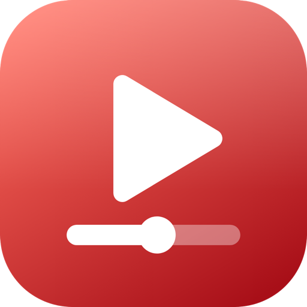

[← Albrhi](../../README.md)

# ▶️ Albrhi for YouTube

## 💾 Save a video — and keep saving it after YouTube updates
Tap YouTube's **own download button** under a video (Shorts get a save button of their own, beside
like and share). A sheet offers the qualities and, separately, **sound only**, which is saved as a
proper `.m4a` with the video's cover art. It lands in the Download Centre with a percentage.

**How it gets the file changed in 1.34.0, and the reason is resilience.** YouTube no longer hands the
app file links, so anything read *out of the app* breaks whenever the app changes. Albrhi now asks
YouTube **itself**, as a client that is still served plain files (the *direct route*, the method
[YTKACE](https://github.com/itzzace/ytkace) documents), fetches the file in 8 MB pieces in parallel,
checks that every byte YouTube declared arrived, and assembles the `.mp4` **without FFmpeg and without
re-encoding**.

- **It is anonymous.** No cookie, no account, no login — only a visitor id YouTube gives anyone who asks.
- **The trade:** a video that needs an account (age-restricted, private, members-only) is refused
  there, and the download falls through to the **playlist route**, which carries the app's own session.
  A video that fails once is not asked about twice in a session.
- **What it offers:** H.264 up to **1080p**, and AAC. 1440p and 4K come from YouTube only as AV1 (and
  VP9), which most iPhones cannot play — so they appear only behind a switch (**Offer 1440p and 4K**,
  off by default), are saved untouched as an `.mp4`, and say what they need: VLC, Infuse, a Mac, or an
  iPhone 15 Pro and later. A second, optional switch (**Convert AV1 to HEVC while saving**) decodes
  the AV1 in software and re-encodes it, so an older iPhone plays the file — in Photos too. It takes minutes
  and the app has to stay open; if it cannot finish, the AV1 file is saved as it is. An AV1 file is never
  sent to Photos.
- **The remux is our own**, because AVFoundation was measured reading these fragmented files with every
  timestamp doubled (a 19-second clip reporting 37.9). The boxes are read directly and the frames are
  written with their own timestamps. Checked on a 19 s clip, a 3:33 song and a 10:35 1080p60 film.

## 📁 The Download Centre
A **tab of its own**, beside Home and You — not a panel over the app. YouTube draws the tab itself, so
it has a real label, a real selected state and its share of the width. Inside: everything you have
saved, video and audio, in a player written for the job — landscape fills the screen, double-tap to
jump ten seconds, **picture in picture**, speed, a sleep timer, AirPlay, and it remembers where you
stopped, days later and across restarts. A **mini bar** keeps the sound going while you browse; the
lock screen gets the artwork, a draggable scrubber, and next/previous through your own list. Rename,
share, or send anything to Photos. Simultaneous downloads are a setting.

## 🗂️ Arrange the tab bar
**Settings › Interface › Tab bar** — drag to reorder, drag across to switch a tab off, hide the `+`,
and add **History** as a tab. The bar holds six; one screen enforces that for everything at once.
Every decision is made on a tab's identifier, never its position.

## 🚫 No ads
Blocked where they arrive — the app stops asking for them, promoted rows are dropped from the feed
(through all three doors the feed fills by, so a pull-to-refresh cannot bring one back), and the player
refuses ads before, during and inside a video. Extra gates for the player response, the Shorts list and
subscription pop-ups are installed at runtime **only where the running build declares them**, and each
one counts its own hits in the report.

## ⏭️ SponsorBlock, background playback, and the rest
- **Skip the sponsored parts** using segments other viewers submitted. A short line names what was
  skipped and offers an undo; each segment is **coloured on the progress bar**. Eight categories, each
  with a switch. **Which video you are watching is never sent** — the private lookup is used.
- **Background playback** for YouTube's own video and anything you saved.
- **Playback-error recovery.** The "an error occurred" screen reloads the player and resumes from the
  same second — with a budget of three reloads per video, so a video that truly cannot play is handed
  back to YouTube's own error rather than looped forever.
- **A quality ceiling** separately for Wi-Fi and mobile data, plus the full quality list.
- Silence the update prompt (updating would remove the tweak).

## ⚙️ Settings & diagnostics
**Hold two fingers anywhere.** Arabic and English with RTL, and a card saying whether everything
attached to *your* build. **The report is written when you ask for it** (Settings › General), plus once
if the launch guard has to step in — nothing writes itself on every launch, and a file that can grow has
a 1 MB ceiling. **A launch guard** stands the expensive hooks down if the app has not become active
eight seconds after the tweak loaded, and says so: a tweak may cost a feature, never the app.

> Hooked on YouTube's **model and service layer, never its views** — view classes get renamed between
> releases and a tweak that hooks them quietly stops working.

---
